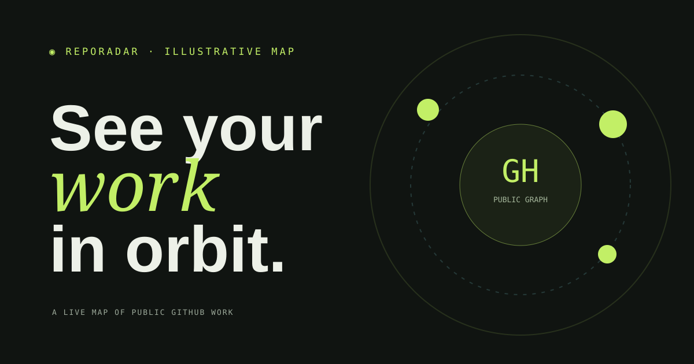

# RepoRadar

**A live, searchable map of any public GitHub profile.** RepoRadar turns a repository list into a visual project index with language mix, star constellation, repository search, filters, and sortable activity.



The artwork is illustrative; profile statistics on the live app are fetched from GitHub when you scan a username.

## Why it exists

A GitHub profile is useful as a directory, but it can be hard to see the shape of someone's work. RepoRadar makes the public portfolio easier to explore. Enter a username or share a link with `?user=octocat`.

## Features

- Reads public profile and owned repository data from GitHub's unauthenticated REST API
- Scans only public repositories; excludes forks and archived projects from the map
- Summarizes project count, stars, languages, and forks
- Renders a language mix and an interactive star constellation
- Searches by repository name, description, or language
- Filters by language and sorts by stars, update time, creation date, or name
- Caches API responses in the current page session to reduce duplicate requests
- Responsive layout, keyboard-friendly controls, and reduced-motion support
- GitHub Pages deployment on pushes to `main`

## Run locally

This is a static site. From the project directory, start any local web server, for example:

```bash
python -m http.server 4173
```

Open `http://localhost:4173`. No package install or secret token is required.

## GitHub Pages

The workflow in `.github/workflows/pages.yml` publishes this repository with GitHub Pages. In repository settings, set **Pages → Build and deployment → Source** to **GitHub Actions**.

## Data and limits

RepoRadar uses GitHub's public REST endpoints without authentication. GitHub applies an unauthenticated rate limit; the app reports the reset time when it is reached. It never asks for a token, requests private repository information, or stores data on a server. Language bars show the share of repositories whose primary language GitHub reports, not lines of code.

## Stack

Vanilla JavaScript modules, semantic HTML, and CSS. GitHub REST API. Hosted on GitHub Pages.

## License

MIT. See [LICENSE](LICENSE).
